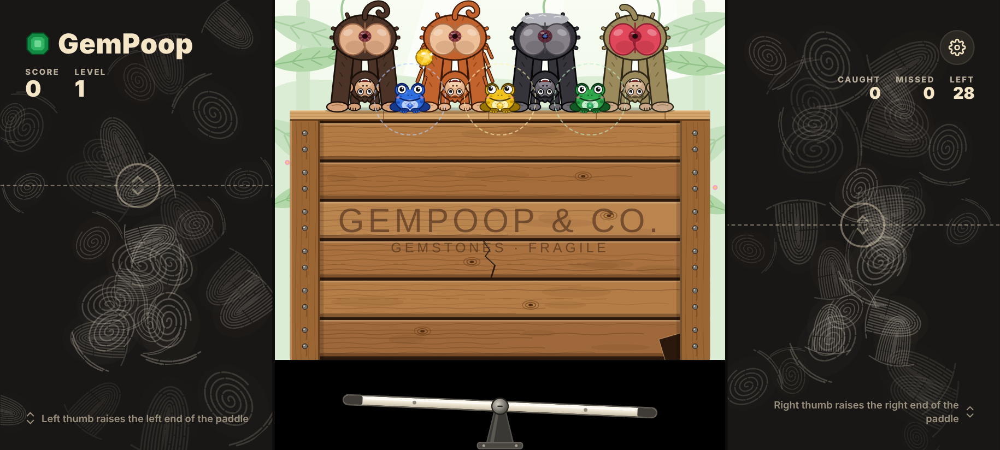
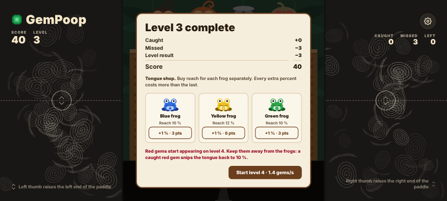

# GemPoop

Ett tvåtummarsspel för liggande skärm. Fyra apor står på en gammal packlår med baken
mot spelaren, och ur deras anus ploppar ädelstenar ut. Din uppgift är att vinkla
paddeln i botten så att varje sten studsar upp till grodan med samma färg.

## Spelplanen

- Spelplanen är kvadratisk och fyller hela skärmens höjd.
- De nedersta 20 % är en svart yta med paddeln. Paddeln är 70 % av planens bredd och sitter fast i mitten.
- Ovanför den svarta ytan står packlåren, 55 % av höjden, byggd av gamla brädor.
- Fyra olika apor står på lådan: en schimpans, en orangutang, en gorilla och en babian.
  Deras anus sitter 8 % från överkanten, vid 20, 40, 60 och 80 % från vänster.
- På lådans kant sitter en blå groda vid 30 %, en gul vid 50 % och en grön vid 70 %.
- Ytorna till vänster och höger om spelplanen är fulla av fingeravtryck. Det är där tummarna styr.

## Så spelar du

- All text i spelet är på engelska.
- Startskärmen har två knappar, **Tutorial** och **Start**. Medan den visas rör sig två genomskinliga
  tummar upp och ner i sidopanelerna, så att paddeln hela tiden vinklas fram och tillbaka.
- Lägg en tumme på varje fingeravtrycksyta. Paddeln lutar efter hur högt tummarna ligger
  i förhållande till varandra. Håller du vänster tumme högre lyfts paddelns vänstra ände.
- En ädelsten anas först i en apas anus och pressas sedan fram under en sekund innan den ploppar ut.
  Under tiden får anus kant stenens färg och sprider ett svagt ljus i samma färg.
- Stenarna faller allt snabbare, studsar mot paddeln och bromsar in på vägen upp i en parabel.
- Kommer en sten inom räckhåll för grodan med samma färg på väg upp skjuter grodan ut tungan och sväljer den.
- När en sten har nått sin högsta punkt efter studsen är den förlorad. Den krymper och försvinner där.
- Färgerna har olika slipform (blå romb, gul rund, grön smaragdslipning, röd trekant).

## Tutorial

1. Målet: en blå sten ploppar ut ur den tredje apan och studsar till den blå grodan, som fångar den.
2. En grön sten ur samma apa studsar till den gula grodan, som låter bli den ("Frogs are kind …").
3. De streckade räckviddsringarna växer i steg medan grodornas tungor pendlar ut till ringen,
   från klockan 2 via 6 till 10 (nedre halvan).
4. Ringarna står på 14 %. En röd sten från den andra apan tas av den gröna grodan. Tungan klipps av
   och faller ner med några bloddroppar, och ringen krymper.
5. Du börjar med 5 credits och förlorar när de går under noll.

## Nivåer, credits och butik

- Du börjar med 5 credits.
- Varje nivå har 30 ädelstenar. Nivå 1 ger 0,4 stenar per sekund, och varje ny nivå lägger till 0,1 (högst 3,5).
- Efter varje nivå dras de missade stenarna av från de fångade, och resultatet läggs till dina credits.
- Hamnar dina credits under noll är spelet slut.
- Mellan nivåerna kan du köpa längre tunga för credits, en procent i taget och för varje groda för sig.
  Varje ny procent blir dyrare: 3, 4, 6, 8, 12, 16, 23 … credits (högst 40 %). Tungorna börjar på 8 %.
- Från nivå 4 kommer ibland röda ädelstenar. Fångar en groda en röd sten klipps tungan av
  till 8 %, och de köpta procenten försvinner. Röda stenar räknas aldrig som missade.
- Andelen röda stenar ökar för varje nivå: 8 % på nivå 4, sedan 5 procentenheter mer per nivå (högst 45 %).
- Bästa resultat sparas i telefonen.

## Inställningar (kugghjulet)

- **Sound effects:** ljud av eller på. Det är den enda inställningen.

## Ljud

Ljuden är inspelade och ligger i `sounds/`:

- `fart_1` … `fart_6`: apornas prutt när en ädelsten ploppar ut
- `slurp_1` … `slurp_5`: grodornas slurp när de fångar en sten
- `sax`: när en röd sten klipper av en tunga

Spelet väljer en slumpvis variant varje gång, aldrig samma två gånger i rad. Ljuden är inbakade i
`index.html` så att spelet fortfarande är en enda fil. Efter att ha bytt eller lagt till filer i `sounds/`
kör man `python3 tools/embed_sounds.py` för att baka in dem igen.

## Teknik

- Själva spelet är `index.html`, utan beroenden. Det går att köra direkt i en webbläsare
  eller via GitHub Pages.
- Android-appen är ett tunt WebView-skal i liggande läge. Navigeringsknapparna är dolda
  under spelet (ett svep från kanten visar dem tillfälligt), och spelet hålls innanför statusfältet.
- GitHub Actions bygger en test-APK vid varje push till `main`. Den publiceras som
  senaste release: `releases/latest/download/gempoop-debug.apk`.
- `design/Main.dc.html` är originalskissen från Claude Design.
- Appen har inga annonser och ingen spårning, och den använder inget nätverk.
